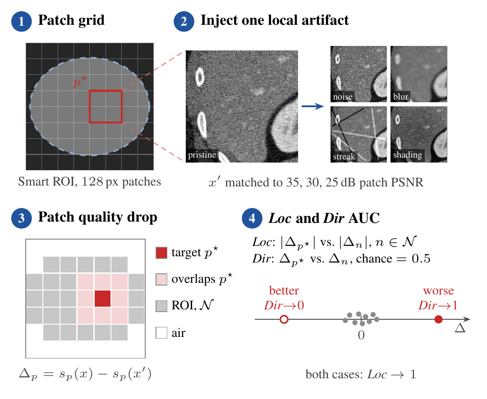
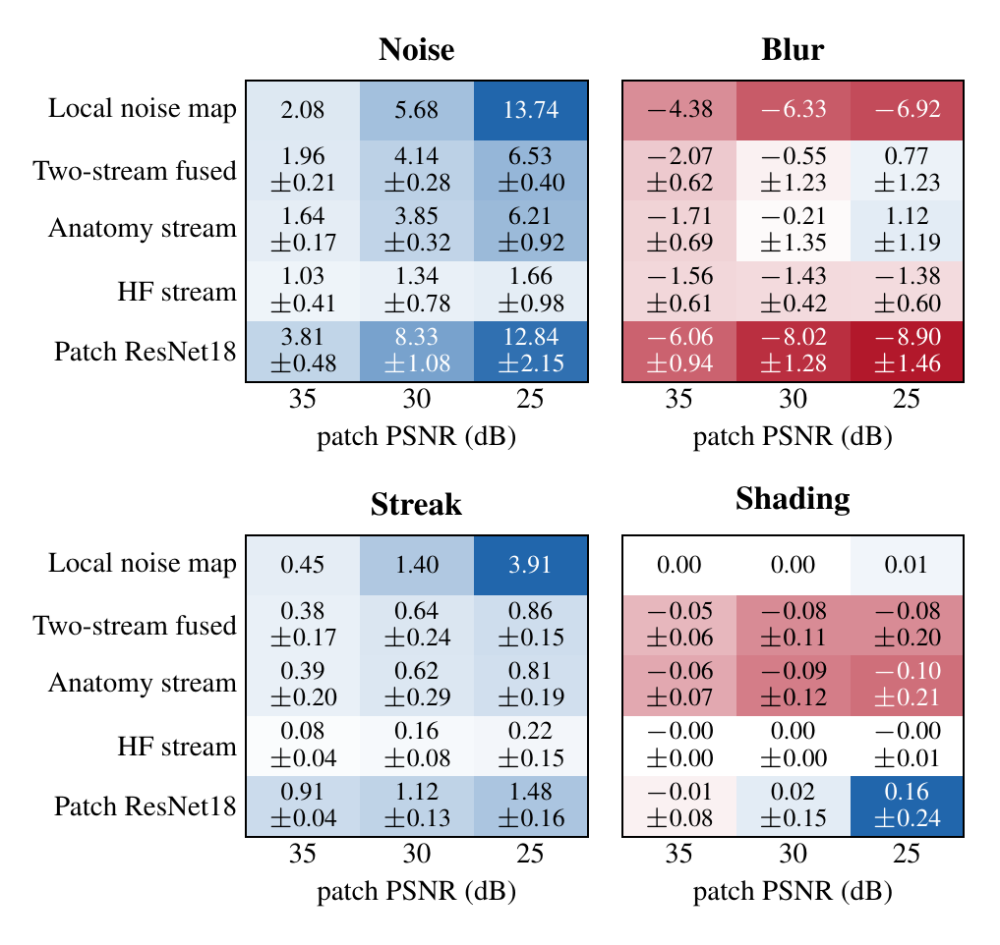
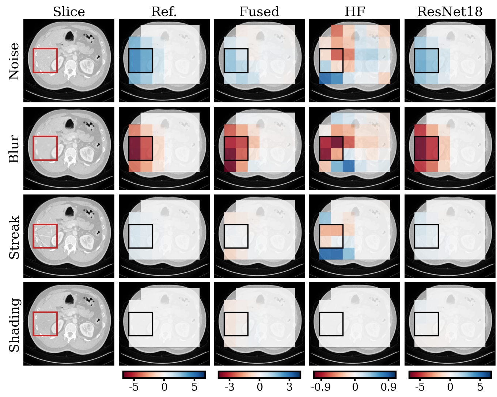

# Do Quality Maps Point at the Artifact? Auditing Regional Low-Dose CT Quality Assessment

[](https://github.com/itu-biai/ldct-iqa-quality-map-audit/actions/workflows/ci.yml)
[](LICENSE)
[](pyproject.toml)

Code for the paper submitted to IEEE ISBI 2027. Repository maintainer: [Mervan Ocal](https://github.com/mrvnocl), [Biomedical Imaging and AI Laboratory](https://biailab.com), Istanbul Technical University ([lab GitHub](https://github.com/itu-biai)).

## Citation

**If you use this code, please cite:**

```bibtex
@inproceedings{ocal2027qualitymaps,
  author    = {Ocal, Mervan and {\"U}nal, Mehmet Ozan and Erta{\c{s}}, Metin and Y{\i}ld{\i}r{\i}m, {\.I}sa},
  title     = {Do Quality Maps Point at the Artifact? Auditing Regional Low-Dose {CT} Quality Assessment},
  booktitle = {Proc. IEEE International Symposium on Biomedical Imaging (ISBI)},
  year      = {2027},
  note      = {Under review}
}
```

## Overview

Regional quality maps of low-dose CT (LDCT) image quality assessment (IQA) models are meant to show where an image is degraded, yet they are judged almost only by global agreement with radiologist scores. This repository audits the maps directly: it injects an artifact of known position and strength into one patch of a slice and checks whether the map responds at that patch and rates it as worse.

## Features

- Localized injection of four LDCT artifacts (noise, blur, streak, shading) at a matched patch PSNR of 35, 30 or 25 dB
- Two metrics per map: **Localization AUC (Loc)** and **Direction AUC (Dir)**, where Dir below 0.5 means the artifact is rated as an improvement
- Seven audited map sources: a two-stream EfficientNet-B0 (fused, anatomy and high-frequency streams, with and without a body mask), a patch ResNet18, a global ResNet18 with Grad-CAM, and a training-free local noise map
- Smart ROI body mask and a test of whether models without it respond to background air
- Wilcoxon tests with Holm correction and bootstrap intervals over slices, five training seeds
- The paper's summary results, so Table 1 can be rebuilt and checked without the data

## Installation

```bash
git clone https://github.com/itu-biai/ldct-iqa-quality-map-audit.git
cd ldct-iqa-quality-map-audit
python -m venv .venv
source .venv/bin/activate
pip install -r requirements.txt
make ci   # unit tests, Ruff format check and Ruff linter
```

Python 3.11 or newer is required. The scripts add `src/` to the import path themselves, so no package installation is needed.

## Dataset

**LDCT-IQA 2023** ([Zenodo 7833096](https://doi.org/10.5281/zenodo.7833096))

- Abdominal low-dose CT slices with radiologist mean opinion scores (MOS) from 0 to 4
- 1,000 training slices, split 80/20 into training and validation sets with a fixed seed; the official 300 test slices are used for evaluation
- The split is at slice level: the release has no patient identifiers, so patient-level grouping could not be verified
- Slices are min-max normalized per image; the audit uses the 168 test slices with MOS of at least 2

The data are not redistributed here. Place them as follows (the image sub-folders are found automatically):

```
data/ldct_iqa_2023/
├── train.json          {"0000.tif": 2.33, ...}
├── test.json           {"test000.tif": 2.67, ...}
├── image/              training slices (.tif)
└── test images/        test slices (.tif)
```

## Usage

### Training

```bash
python scripts/train.py --data-root data/ldct_iqa_2023
```

Trains the four models for the seeds 42, 123, 456, 789 and 1011 and keeps the checkpoint with the lowest validation loss. Finished runs are skipped, so an interrupted job can be restarted.

### Evaluation

```bash
python scripts/evaluate_global.py --data-root data/ldct_iqa_2023   # PLCC, SROCC, KROCC on the test set
python scripts/run_audit.py --data-root data/ldct_iqa_2023         # every injection through every map source
python scripts/analyze.py                                          # tests, Table 1, intervals, background analysis
python scripts/make_figures.py --heatmap-values outputs/heatmap_values.csv \
    --example-maps --data-root data/ldct_iqa_2023                   # Fig. 2 and Fig. 3
```

The audit uses `manifests/benchmark_manifest.csv`, so the target patches and severities are exactly those of the paper; `scripts/make_manifest.py` shows how the manifest was built. Without the data, Table 1 can be rebuilt from the shipped results:

```bash
python scripts/analyze.py --from-summary results/paper_5seed
```

### Configuration

All settings are in the frozen `Config` dataclass in [`src/config.py`](src/config.py):

```python
from dataclasses import dataclass


@dataclass(frozen=True)
class Config:
    patch_size: int = 128
    patch_stride: int = 64
    target_psnr_db: tuple[float, ...] = (35.0, 30.0, 25.0)
    seeds: tuple[int, ...] = (42, 123, 456, 789, 1011)
    num_epochs: int = 25
    batch_size: int = 32
    learning_rate: float = 1e-4
    # ... other parameters


CONFIG = Config()
```

Scripts accept `--data-root`, `--output-dir` and `--seeds`; other changes are made in `src/config.py`.

## Architecture



1. A Smart ROI body mask (Otsu threshold, morphological opening, largest component, hole filling) defines a grid of 128 x 128 patches with a stride of 64 px, and a target patch $p^\star$ is drawn inside the anatomy.
2. One artifact is injected into $p^\star$ only, with a feathered mask, and its severity is set by bisection until the patch PSNR matches the target.
3. Each map source scores every patch before and after injection; the drop is $\Delta_p = s_p(x) - s_p(x')$.
4. **Loc** compares $|\Delta_{p^\star}|$ with the drops of the non-overlapping ROI patches; **Dir** compares the signed drops (Mann-Whitney AUC, ties count 0.5).

The audited two-stream model scores each patch from an anatomy stream and a Haar wavelet HH high-frequency stream (two EfficientNet-B0 backbones whose features are concatenated); HH-std weights aggregate patch scores into the image score. All models are trained for 25 epochs with Adam (learning rate 1e-4), Smooth L1 loss, batch size 32 and ReduceLROnPlateau.

## Results

Mean over five seeds, 168 test slices, 35 to 25 dB pooled ([full Table 1](results/paper_5seed/table1_5seed.md), [LaTeX](results/table_1.tex)):

| Map source | Global SROCC | Noise Dir | Blur Dir | Streak Dir | Shading Dir |
| --- | --- | --- | --- | --- | --- |
| Local noise map (reference) | - | 1.0000 | 0.0000 | 1.0000 | 0.7574 |
| Two-stream, fused, ROI | 0.9270 | 0.9791 | 0.4085 | 0.7139 | 0.4430 |
| HF stream | - | 0.8081 | 0.2277 | 0.5527 | 0.5109 |
| Two-stream, fused, no ROI | 0.9353 | 0.9245 | 0.5530 | 0.6816 | 0.5066 |
| Patch ResNet18 | 0.9243 | 1.0000 | 0.0000 | 0.9086 | 0.5394 |

All maps penalize noise, but none penalizes blur reliably: the fused map's blur Dir ranges from 0.23 to 0.53 across seeds, and the high-frequency stream rates blur as an improvement in every seed. The model trained without a mask responds more to noise in background air than in anatomy, and the Smart ROI mask removes this at a cost of less than 0.01 global SROCC.



*Fig. 2. Normalized drop $\Delta_p/\sigma_{\mathrm{clean}}$ of the target patch, mean and std over five seeds (blue: quality drop, red: increase).*



*Fig. 3. Example maps (seed 42, 30 dB; box: target patch). For blur, the local noise map and Patch ResNet18 rate the patch as better.*

This code is a cleaned-up version of the Colab notebooks used for the paper; the computations are unchanged. It was checked against the seed-42 paper models: global SROCC and patch scores match the original code. Results can differ slightly between GPU types (for example with TF32 enabled); cells where the target patch barely responds, such as the HF stream under shading, are the most sensitive to this.

## Project Structure

```
.
├── README.md
├── LICENSE (CC BY-NC 4.0)
├── CITATION.cff
├── Makefile                 format, lint, test, ci
├── pyproject.toml           Ruff and pytest settings
├── requirements.txt
├── assets/                  figures used in this README
├── manifests/
│   └── benchmark_manifest.csv   injections of the paper
├── results/
│   ├── table_1.tex          Table 1 of the paper
│   └── paper_5seed/         summary results of the five seeds
├── scripts/
│   ├── train.py             train the four models for every seed
│   ├── evaluate_global.py   global PLCC, SROCC, KROCC
│   ├── make_manifest.py     build the injection manifest
│   ├── run_audit.py         Loc and Dir AUC of every injection
│   ├── analyze.py           statistics and tables
│   └── make_figures.py      Fig. 2 and Fig. 3
├── src/
│   ├── config.py            all settings (dataclass)
│   ├── data.py              MOS tables, slice reading, split
│   ├── roi.py               Smart ROI body mask
│   ├── preprocessing.py     anatomy and HH channels
│   ├── models.py            two-stream EfficientNet-B0, ResNet18
│   ├── training.py          training loop
│   ├── artifacts.py         artifact injection, PSNR calibration
│   ├── patches.py           patch grid helpers
│   ├── map_sources.py       model maps, local noise map, Grad-CAM
│   ├── metrics.py           Loc, Dir and global metrics
│   ├── audit.py             manifest and per-seed audit
│   ├── stats.py             Wilcoxon, Holm, bootstrap
│   ├── tables.py            Table 1 and summaries
│   ├── figures.py           figure drawing
│   └── cli.py               shared command-line helpers
└── tests/                   unit tests and a check of Table 1 against the paper
```

## References

- W. Lee et al., "Low-dose computed tomography perceptual image quality assessment," *Medical Image Analysis*, vol. 99, 2025. (LDCT-IQA 2023 dataset)
- R. R. Selvaraju et al., "Grad-CAM: Visual explanations from deep networks via gradient-based localization," *ICCV*, 2017.
- J. Adebayo et al., "Sanity checks for saliency maps," *NeurIPS*, 2018.
- S. Holm, "A simple sequentially rejective multiple test procedure," *Scandinavian Journal of Statistics*, vol. 6, no. 2, 1979.

## License

This project is licensed under CC BY-NC 4.0 (Creative Commons Attribution-NonCommercial 4.0 International). Non-commercial research and educational use is permitted with attribution; commercial use requires prior written permission from the authors. See the [LICENSE](LICENSE) file for details.

## Contact

For questions, please [open an issue](https://github.com/itu-biai/ldct-iqa-quality-map-audit/issues).
